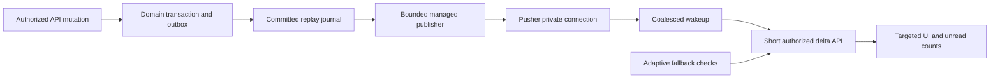

# Live operations and maintenance — November 2026

The application remains PHP 8.3/MySQL with vanilla JavaScript. This update **replaces the earlier PHP-held SSE implementation** after UAT identified request blocking and repeated reconnections. No React/Laravel migration or always-running process is introduced.

## Delivery architecture

Pusher handles persistent connections. PHP handles short ordinary requests and bounded outbound publications. **No application path keeps a PHP worker waiting for live events.** The retired `/api/realtime/events` endpoint returns HTTP 410 for an authenticated request. Existing tabs need one reload after replacing the client.

See [Managed live updates on DirectAdmin](MANAGED_REALTIME_DIRECTADMIN.md) for account creation, private configuration and production connection checks. Until the provider app is configured, the UI displays **Automatic updates**, using short adaptive checks. Managed push is implemented and tested with a mock provider; a real Pusher connection has not been verified because the account/app does not exist yet.

### Reliability and efficiency

- Mutations write small events into their database transaction. A serialized, nonlocking-snapshot dispatcher assigns replay IDs only after commit, including transactions whose lower outbox ID commits late. Rollbacks publish nothing.
- Journal inserts/deletes use bulk statements rather than a separate database round trip for every row. A provider request coalesces up to a thousand pending signals and at most one hundred private channels. It sends only `{changed:true}`.
- PHP-FPM completes the user response before bounded provider work. Other PHP runtimes use strict connection/request timeouts. A shared circuit breaker prevents an outage from delaying every mutation; a durable delivery checkpoint supports retry by the existing notification cron.
- The first delivery failure records an operational incident and sends a permission-scoped administrator alert. Existing email opt-in rules still apply. System settings → Maintenance shows the configured delivery mode and last successful publication without exposing credentials.
- Frequent delta reads have a separate lightweight entry point, release the session without rewriting its expiry and avoid loading the document/AI/mail application graph. No heartbeat audit records are written.
- One request can be in flight per elected tab. Wakeup bursts coalesce, idle fallback checks slow to roughly 4–15 seconds, HTTP failures back off, and hidden tabs stop requests/connections. Web Locks and BroadcastChannel share transport between tabs where supported.
- Managed connections have a thirty-second safety delta check. Checkpoints, duplicate filtering and authorized replay recover missed changes. Active pages refresh affected data; they are not reloaded after every signal. Initial transport startup does not refetch every management page.
- Provider outages fall back to automatic checks without a repeated “reconnecting” warning. No UI claims that this fallback is instant push.

### Authorization and privacy

The server derives the recipient and allowed topics from the current session. User streams exclude other accounts. Administrator scopes follow current module permissions. Private subscription authorization is batched, CSRF protected and checked against a server-derived channel allowlist. Socket/channel parameters cannot grant broader access.

The managed provider receives generic wakeups and ordinary connection/channel metadata. It does not receive resume text, support messages, contact details or credentials in event payloads. The wakeup itself cannot mutate application state: the client requests replay through ReGen's permission-checked API. Removing a permission takes effect in content/delta APIs immediately; open private viewers close on access reconciliation.

The journal retains one day of replay signals. Persistent user/admin notification history uses its existing tables and is independent of that retention. Optional toast/browser/email consent remains separate from mandatory data synchronization. Closed-tab service-worker Web Push remains unimplemented and is not represented as an existing capability.

## Maintenance

Apply missing migrations through **019_support_and_token_store.sql**. Migration 017 supplies maintenance controls and replay tables; 018 supplies the durable managed-delivery checkpoint. Migration 019 adds the token store and private support files. These migrations are additive. See [store and attachment deployment](TOKEN_STORE_PHASE_ONE.md). Fresh installations use the current schema.

System settings → Maintenance supports normal access, immediate activation, a scheduled start/end, an indefinite period, custom title/message, an independent restoration estimate and an authorized preview. Inputs use Malaysia time (MYT, UTC+08:00), storage is UTC and invalid schedules/revision conflicts are rejected.

The backend evaluates the schedule on each protected request. It restricts workspace pages, direct URLs, user APIs, auth flows and existing sessions. The public landing page and narrow health/status/update/logout infrastructure remain accessible. Admin routes retain their normal authorization and remain available to restore service.

Connected users move to the branded maintenance page. Schedule-boundary timers and public status recovery restore access automatically at the end. The estimate alone does not end maintenance. Maintenance pages exclude protected notification/feedback initialization; browser testing caught and corrected the redirect loop caused by that interaction. Draft stores and the saved return destination remain intact.

## Private saved resumes

Template management distinguishes the latest current resume per user, selection history, and actual saved resume records. Usage lists search and paginate twenty records, including older saved records using the selected design. Template gallery previews do not count as saved resumes.

The separate `templates.resumes` permission also requires `templates.view`; a delegated editor does not receive private access merely by gaining template change access. The list, HTML and PDF APIs validate both permissions and the saved record/template relationship. The read-only viewer uses the original PDF export and shared PdfPages renderer. Private views are audited and excluded from offline caches.

## Interface changes

- Header notifications have one entry point. Sidebar work badges show real open/in-progress tickets and new feedback, distinct from unread alerts.
- Expanded/collapsed/mobile navigation, circular avatar fallbacks, focus states and badge positioning share one layout. The dark sidebar retains a light brand mark regardless of page theme.
- Account activity shows a concise retained history with device/browser context and a searchable audit destination.
- Text-only campaign details omit token explanations. Close buttons use centered SVG strokes and 44-pixel targets.
- Saved cover-letter company/role search uses compact inputs/results and existing pagination. There is no external company autocomplete service in this repository.
- Shared PDF styles/rendering, retry states and read-only viewer spacing work across desktop/mobile. Form defaults use POST to avoid query-string exposure if JavaScript fails.

## Executed verification and limits

- `composer check`: PHP syntax/autoloading, page assets, templates, writing, assistance and mail configuration.
- `check-live-operations.php`: 31 assertions covering authorization, commit ordering, replay, maintenance schedules and private resume permissions.
- `check-managed-realtime.php`: 22 assertions covering private signatures/scopes, one-thousand-event batching, recipient limits, rollback, failure isolation, operational incidents and durable retry. Provider transport is mocked.
- `check-realtime-client.mjs`: 21 assertions covering short checks, cancellation, backoff, burst coalescing, replay, SDK shutdown and private authorization batching. Transport is mocked.
- `check-live-http.php`: 44 assertions against the real PHP single-worker HTTP server, with separate user/two-admin sessions, campaigns, support replies/counts, private HTML/PDF access, maintenance and automatic end. No external email or paid AI call.
- `check-live-performance.php`: a local mixed-request diagnostic: 100 authenticated requests, ten in flight, no failures; latest p50 675 ms, p95 743 ms, max 793 ms. This measures a single-worker Windows development fixture. It is not a production load/capacity guarantee. Metrics are saved in `output/live-uat/php-concurrency.json`.
- Browser review verified both directions of support updates with drafts preserved, unread-count updates, desktop/mobile presentation, private PDF rendering, and automatic maintenance entry/return. Screenshots remain in `output/live-uat`, outside the release.

The earlier 100-account mocked email test is not a concurrent-browser benchmark. Production still needs actual Pusher connectivity, PHP/DB capacity and load testing on the intended hosting plan, HTTPS, notification-cron execution, real inbox delivery and actual-device PWA checks. No production deployment was performed.

References: [Pusher private channels](https://pusher.com/docs/channels/using_channels/private-channels/), [HTTP publishing](https://pusher.com/docs/channels/server_api/http-api/), [PHP single-worker development server](https://www.php.net/manual/en/features.commandline.webserver.php).
